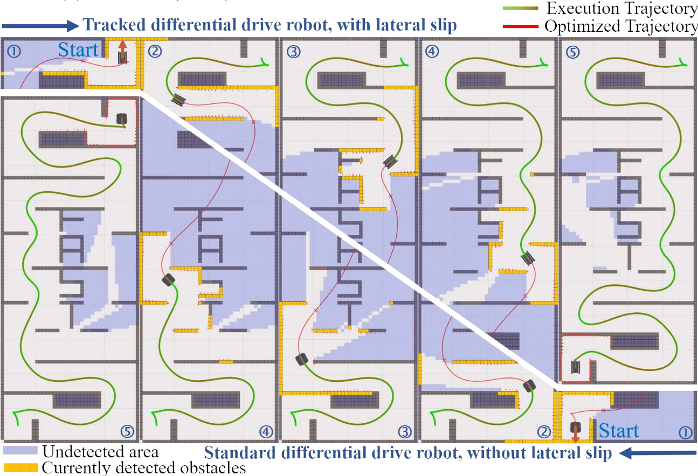

# DDR-opt

DDR-opt is a universal Trajectory Optimization Framework for Differential Drive Robot Class.

The paper is published in T-ASE!

Please visit our project website [DDR-opt](https://zju-fast-lab.github.io/DDR-opt/).
If you find this work useful or interesting, please kindly give us a star ⭐, thanks! 😀

<p align="center">
    
</p>

## Quick Start
Compiling tests passed on ubuntu **18.04, and 20.04** with ros installed.
You can just execute the following commands one by one.
### Dependence:
``` bash
sudo apt install ros-${ROS_DISTRO}-tf2-sensor-msgs # noetic or melodic
```

OSQP and OSQP-Eigen make it easier to modify parameters and are used to solve control problems under velocity and angular velocity control.
You can download them from the following two links:
- Download [osqp-v0.6.3-src.tar.gz](https://github.com/osqp/osqp/releases/tag/v0.6.3) or click [here](https://github.com/osqp/osqp/releases/download/v0.6.3/osqp-v0.6.3-src.tar.gz), and then follow the [installation instructions](https://osqp.org/docs/get_started/sources.html)
- Download [OSQP-eigen v0.8.1](https://github.com/robotology/osqp-eigen/releases/tag/v0.8.1).
```bash
cd osqp-eigen
mkdir build
cd build
cmake -DCMAKE_INSTALL_PREFIX:PATH=/usr/local ../
make
sudo make install
```

**NOTE:** We may have forgotten other dependencies 😟, sorry! If you could provide missing dependencies, we would greatly appreciate it. 

### Build
``` bash
mkdir -p DDRopt_ws/src
cd DDRopt_ws/src
git clone git@github.com:ZJU-FAST-Lab/DDR-opt.git
cd ..
catkin build
```

### IMPORTANT: For this device, run the following commends before running plan_manager launch files  ###
``` bash
cd ~/main/pr_robot/DDRopt_ws
source /opt/ros/noetic/setup.bash
catkin build
source devel/setup.bash    ## Must run this command
rospack find plan_manager
```

### Run
You can run any of the following: 
``` bash
roslaunch plan_manager planner_nmpc.launch # for robots controlled by wheel speeds
roslaunch plan_manager planner_sim_unknown.launch # for planning in unknown space
roslaunch plan_manager planner_sim.launch # for robots controlled by linear and angular velocity
```

You can use `2D Nav Goal` to set goal point.  

### Robot model (branch `DDR-test-v1`): ROV V4 by default, original car with `robot:=car`
All three launch files take `robot:=rov` (default) or `robot:=car`:
``` bash
roslaunch plan_manager planner_sim.launch                 # ROV V4
roslaunch plan_manager planner_sim.launch robot:=car      # original scout_mini car, unchanged
```
- **ROV V4** (`ROV_simple_model_V4`, mesh `utils/simulator/urdf/ROV_V4.STL`).
  - `plan_manager/config/robot_rov.yaml` is loaded on top of the stock configs. It sets the limits, the collision
    circle and the mesh.
  - Collision radius 0.722 m (assembly 1.0 × 1.043 m including thrusters). Optimizer target 1.022 m, path search
    0.872 m, final rejection below 0.722 m.
  - Limits are placeholders until mass, drag and T500 thrust data exist: 1.0 / −0.3 m/s, 0.4 m/s², 0.8 rad/s.
  - DDR-opt treats the ROV as a differential-drive robot (surge + yaw). It doesn't use the ROV's sideways (sway)
    ability.
- **Environment** for the ROV, the same in all three launch files: 20 random 1 m boxes, `map_seed` 10, start
  (−7.75, −0.5).
  - The stock maps (100 boxes, or `obs5` with 65) leave the 1.04 m ROV room in only 19–50% of the map.
  - With this map it fits in about 60% of the map (the car on its stock maps: 52–66%), and every place it fits is
    reachable.
  - **Goal snapping (ROV):** a goal clicked closer than ~0.97 m to a box or wall is moved to the nearest valid spot
    within 1.5 m. The terminal shows a yellow warning `Goal (...) ... moved X m to (...)`. Only if no valid spot is
    that close does the planner report `Goal dropped` and stay still.
  - Set by `goal_snap_radius` in `robot_rov.yaml`; the car has it off (original behaviour).
  - `map_seed:=-1` gives a new random map.
- Other args: `gui:=false` (no rviz/plotjuggler), `map_seed:=N`.
- Headless check: `scripts/run_headless_sim.sh --launch planner_sim|planner_nmpc|planner_sim_unknown --robot rov|car|rov_holo`
  (exit 0 = PASS). `rov_holo`, or `--multigoal` with `rov` / `car`, runs `scripts/multigoal.py`: 14 goals across the
  map, with path length, time, clearance and tracking per goal in `multigoal.json`.

### ROV as a planar holonomic vehicle: `robot:=rov_holo`
``` bash
roslaunch plan_manager planner_sim.launch robot:=rov_holo     # also planner_nmpc / planner_sim_unknown
```
Same map, start, collision circle and goal snapping as `rov`, but the ROV uses its sway:
- **Planner** (`back_end/.../holo_optimizer.h`, `HoloPlanner`).
  - The flat output is the pose (x, y, θ), one MINCO minimum-jerk polynomial per axis (`gcopter/minco_holo.hpp`).
  - Body velocities come straight from it: vx = cos θ ẋ + sin θ ẏ, vy = −sin θ ẋ + cos θ ẏ, ω = θ̇. There's no
    (yaw, arc-length) integration, ICR slip or wheel coupling.
  - Reused from DDR-opt: JPS front end and its (x, y, yaw) samples as the initial guess, L-BFGS, the
    virtual-time map and the smoothed-L1 penalties.
  - Penalties:
    - independent vx / vy / ω limits;
    - the body-velocity rates d(vx)/dt, d(vy)/dt, dω/dt (= R^T p̈ − ω S v_b). The NMPC rate limits and the simulator
      bound the same quantities with the same yaml values;
    - ESDF clearance;
    - thruster reachability.
  - Thruster reachability:
    - The planar wrench m R^T p̈ + D v_b, N = Iz ω̇ + d_r ω must satisfy the 12 facet inequalities n_k · τ ≤ h_k of
      the zonotope {B_h f : f_min ≤ f ≤ f_max} of the 4 horizontal thrusters.
    - This matches an exact per-thruster feasibility test with zero mismatches on random wrenches; see
      `holo_control/scripts/check_allocation.py`.
    - Heave, roll and pitch are not part of it, because the vertical thrusters can always cancel them (at most
      ~5.5 N per vertical thruster).
  - The `reserve` (0.2) is **arbitrary**. It is not derived from any disturbance model, and it is equivalent to
    planning every horizontal thruster within [−23, 33] N instead of [−30, 40] N.
  - Start and goal are hard boundary conditions of the MINCO polynomial (not penalties), so the PHR-ALM endpoint
    constraint DDR-opt needs is not used. The planner logs the residual (`endpoint error`, ~1e-15).
  - Initial guess: the JPS path geometry resampled by arc length, heading along the path, timed from the surge
    limits. The diff-drive "rotate then drive" timing is not used.
  - Limits are soft penalties. The penalties aim at 95% of each limit (`limit_margin`), and every result is checked
    every 0.01 s against the limits themselves with zero tolerance (`limit_tolerance: 0.0`).
    - Any excess: the limit weights are multiplied by 10 and the next attempt re-optimizes, warm-started from the
      previous solution (up to 6 attempts).
    - After the last attempt, if the start is at rest, the same path is slowed uniformly in time (up to 4×) until
      it complies. Clearance and boundary conditions are unchanged. This is needed when the escalation stalls near
      walls, where the collision and limit penalties pull against each other.
    - A plan that still fails is not published. During a replan the ROV keeps executing its current (verified)
      trajectory while the rest of it stays clear of the updated map, and the next replan cycle tries again.
      Otherwise the goal is dropped and the ROV stops (`Holonomic optimizer failed! Goal dropped`).
  - Unknown space: the ROV keeps its current trajectory and replans only when the updated map brings it within the
    path-search clearance, or when a partial trajectory has less than 3 s left. Replanning every 0.08 s made it
    dither between routes.
  - If the start is already within the path-search clearance, the path search starts from the nearest free spot
    within 1 m, and the optimizer may plan a way out.
- **Trajectory message**: `Polynome.model = HOLONOMIC`, vectors carry (x, y, θ).
- **Controller** `holo_control/holo_nmpc`.
  - Real-time-iteration NMPC on the holonomic kinematics, solved with OSQP. ACADO is not installed here, so the
    car's ACADO NMPC could not be regenerated; it is unchanged.
  - Output: body (vx, vy, ω) on `/simulation/HoloCmd`. Input boxes and rate limits apply.
  - Horizon 20 × 0.1 s (prediction = control horizon, 2 s); one QP per 50 Hz cycle.
  - `/holo_nmpc/stats` publishes [cycle ms, OSQP solve ms, OSQP iterations, ok, timer period ms].
  - `/holo_nmpc/ref_pose` publishes the reference pose at the current time.
- **Allocation** `holo_control/thruster_allocation`.
  - QP over all 8 thrusters (B is 6×8, rank 6):
    min ½‖B_p f − τ_p‖²_W + ½ε‖f‖² s.t. Z = K = M = 0 (hard equalities), f_min ≤ f ≤ f_max.
  - τ_p = (m(v̇x − ω vy) + d_u vx, m(v̇y + ω vx) + d_v vy, Iz ω̇ + d_r ω), the same wrench the planner bounds.
  - If the equalities are infeasible, it falls back to 6-axis weighted least squares and reports `saturated`.
    This can't happen with the current placeholders, but could once real buoyancy or CoM offsets are added.
  - Publishes `/thruster_allocation/thrust` (CSV order), the desired and achieved wrench, and `saturated`.
  - The kinematic simulator does **not** use the thrusts.
- **Simulator**: holonomic kinematics with per-axis acceleration limits.
- **State estimation**: no ICR-EKF (it estimates wheel slip). The planner and NMPC use the simulator's
  ground-truth odometry. TODO: a real ROV estimator.
- **Config**: `plan_manager/config/robot_rov_holo.yaml` (limits, model, weights) and `rov_thrusters.yaml` (layout).
- **All dynamic numbers are PLACEHOLDERS.**
  - Speeds 1.0 / −0.3 / 0.5 m/s, 0.8 rad/s; accelerations 0.4 / 0.3 m/s², 1.0 rad/s².
  - Dry mass 50 kg; effective mass 120 kg and effective Iz 16.4 kg m², both including a 70 kg added-mass
    placeholder; linear drag 100 / 125 / 80; CoM (−0.064, 0, −0.007); T500 thrust −30 to +40 N.
  - These are shared with the Gazebo model; see "Physics placeholders" below.
  - Mass, inertia, drag and thrust curves are null in `simulation_parameters.json`. Passing these limits does
    **not** show that the real ROV can fly the trajectory.
- **Not modelled**: heave, roll and pitch (constant depth assumed), added mass, quadratic drag, currents, the arms.
  Z = 0 assumes neutral buoyancy, and moments are about the hull-envelope centre (CoM unknown).
- **Debug**: `rosparam set /global_planning/holo/gradient_check true` makes every plan compare the analytic
  gradient with finite differences.

### ROV_V4 in a Gazebo pool: `rov_gazebo_bridge` (branch `rov-gazebo-v1`)
The `rov_holo` planner, NMPC and thruster allocation run unchanged on ROV_V4 in the uwv-simulator Gazebo pool
(freefloating_gazebo buoyancy, linear drag and thruster plugins). Gazebo replaces DDR-opt's 2D `simulator`,
`global_map_node` and `icrekf`.
``` bash
# needs src/uwv-simulator and src/freefloating_gazebo next to DDR-opt-main (not part of this repo)
DISABLE_ROS1_EOL_WARNINGS=1 roslaunch rov_gazebo_bridge planner_gazebo.launch     # rviz; gui:=true adds gzclient
#   scene:=empty (no obstacles) | scene_file:=<your yaml> | start_x/start_y/start_yaw
scripts/run_headless_gazebo.sh [--no-build] [--goal X Y YAW]                      # hold + 14 goals + stop tests
```
- **Frame:** DDR-opt's `world` is the pool corner. The 25 × 50 m pool is x ∈ [0, 25], y ∈ [0, 50], which is Gazebo's
  world + (12.5, 25). The start (`start_x/y/yaw`, default (5, 5, 0)) and goals are in this frame.
- **`gazebo_bridge`:**
  - **Odometry:** `/rov_v4/sim_ground_truth` → `~odom`, giving the planar pose and the heading-frame body twist, the
    same convention as `/simulation/PoseOdomPub`.
  - **Thrust:** `/thruster_allocation/thrust` → `/rov_v4/thruster_command`, matched **by name** through
    `config/bridge.yaml` `thruster_map` (CAD instance → Gazebo name).
  - **Depth and attitude hold:** a depth PID (1.0 m, `~depth_target`) and a roll/pitch PD, plus a constant
    −3.92 N (downward) feed-forward that cancels the +3.92 N net buoyancy. The resulting heave force and
    roll/pitch moments go to `~zkm`.
- **`thruster_allocation`** in Gazebo mode (`holo_control.launch gazebo:=true`):
  - Heave, roll and pitch are hard equalities at the bridge's targets.
  - A body-velocity feedback term is added: τ += K (v_cmd − v_meas), K = (105, 105, 28).
  - The inertial feed-forward is scaled by `feedforward_scale` 0.7. Both values are ×0.7 of the nominal ones,
    chosen to reduce clamping (placeholders).
  - It runs at 50 Hz even without commands.
  - The 2D mode is unchanged apart from the effective mass below.
- **Pool scene** (`pool_scene.py`, `config/pool_scene.yaml`; `scene:=empty` = walls and lanes only):
  - **Pool:** standard 50 m long-course competition pool, 50 × 25 m and 2 m deep (World Aquatics / Olympic; China's
    national standard is the same 50 × 25 m with 10 lanes). The Gazebo pool model already had this size; the SAUVC
    props are not spawned.
  - **Lanes:** 10 lanes of 2.5 m, so 9 lane lines along y at x = 2.5, 5, …, 22.5. They float at the surface in
    blue/white 5 m segments. They are **visual only**: no collision in Gazebo, and not in the planner's map.
  - **Obstacles:** floor-to-surface columns, defined by hand in `pool_scene.yaml`.
    - Default scene: **16 static** pillars and blocks (orange), s1–s16.
    - Moving obstacles are supported (red) but none are set right now. In the yaml, `dynamic:` entries with motion
      `line` or `circle` become kinematic Gazebo models moved along their path in sim time.
  - **What the planner sees:** the walls plus every obstacle at its current position, as a point cloud.
    `laser_simulator` (`dynamic_map: true`, re-reads every cloud) passes it to the planner. The planner's map
    (`if_dynamic_map: true`) clears what the sensor sees again, so a moved obstacle leaves no trail.
  - **Moving obstacles:** DDR-opt has **no motion prediction**; it sees only where each obstacle is now. With
    `replan_time` 0.08, rov_holo replans when the updated map comes within `jps_safe_dis` of the remaining
    trajectory. Keep obstacle speeds well below the ROV's.
  - **Defaults:** both dynamic-map parameters default to false, so the car, `rov` and the 2D `rov_holo` launch files
    are unchanged.
  - **RViz** (`rviz/pool.rviz`): lanes, obstacles and the ROV_V4 mesh (green, `/gazebo_bridge/robot_marker`).

#### Stops
Gazebo keeps applying the last thruster command forever, so "off" always means actively sending zeros.

| | Safety stop | Planning stop |
|---|---|---|
| Triggers | collision: the robot centre is inside an obstacle (planner, `/safety_stop`); manual: `rostopic pub /rov_safety/estop std_msgs/Bool true`; comm loss: no allocation output for 0.2 s or no ground truth for 0.5 s | replan failure, goal dropped (`/planner/emergency_stop`) |
| Effect | **all 8 thrusters 0, latched**; allocation output is ignored; the planner drops the goal; the NMPC stops | planar command stops; **depth and attitude hold continue** |
| Re-enable | **manual only:** `rosservice call /gazebo_bridge/reset_safety_stop`, then a new goal | the next valid goal |

- Shutting down the bridge also sets all 8 thrusters to 0.
- `scripts/run_headless_gazebo.sh` tests all five cases after the 14 goals.

#### Physics placeholders
DDR-opt yaml = `uwv_description/urdf/rov_v4.xacro`; change both together. **All values are placeholders.**

| Parameter | Value | Note |
|---|---|---|
| Dry mass `mass_dry` | 50 kg | set by the user; gravity only |
| Displaced volume | 50.5 L | watertight volume + solid parts. The 153 L of the CAD mesh is the outer envelope; ~102.5 L is free-flooding |
| Water density | 998 kg/m³ | fresh pool water |
| Buoyancy | compensation ρV/m = 1.008 → 494.4 N vs 490.5 N weight | net **+3.9 N (0.8%)** |
| CoB | (−0.064, 0, 0.023) | centroid of the outer envelope. **TODO: CoB must be updated once watertight compartment and foam positions are known.** |
| CoM, used for all moments (`thrusters/moment_ref`) | (−0.064, 0, −0.007) | |
| Added mass, surge / sway / heave | 70 / 70 / 80 kg | entrained water + hydrodynamic added mass; inertia only |
| Added inertia, roll / pitch / yaw | 4.26 / 6.36 / 9.57 kg m² | |
| `mass_effective` | 120 kg | 50 + 70; feeds the planner's reachability constraint and the allocation feed-forward |
| `inertia_z_effective` | 16.4 kg m² | 6.83 (solid box) + 9.57; same use |
| Linear drag, surge / sway / yaw | 100 / 125 / 80 | vec6's arbitrary values scaled by projected area. Real drag is mostly quadratic |
| Thrust | Gazebo clamps at ±40 N; DDR-opt plans within [−30, 40] N | arbitrary, pending the T500 table at the working voltage |

**Speed and acceleration limits.**
- **The nominal limits are not reachable at speed.** They are vx ≤ 1.0, |vy| ≤ 0.5, |ω| ≤ 0.8,
  |v̇x| ≤ 0.4, |v̇y| ≤ 0.3, |ω̇| ≤ 1.0. The planner's thrust-reachability constraint tightens them.
- **Thrust envelope** within the 20% reserve:
  - surge: 120·v̇x + 100·vx ≤ 93 N, so 0.4 m/s² is only possible below ~0.45 m/s, and steady surge stays below
    ~0.93 m/s;
  - sway: 120·v̇y + 125·vy ≤ 79 N;
  - yaw: 16.4·ω̇ + 80·ω ≤ 53 N m, so steady |ω| stays below ~0.66 rad/s.
- **Measured** on the 14-goal run: peaks vx 0.86, |vy| 0.42, |ω| 0.60, |v̇x| 0.40, |v̇y| 0.28, |ω̇| 0.65.

**Depth precision:** ±5 cm today. TODO: approach/docking will need ≤ 2 cm, which needs a better depth controller
and a real depth sensor and estimator.

**uwv standalone PID controller** (`uwv_control`, `sim_rov4_remote_control`): tuned at 150 kg, not retested at
50 kg. The DDR-opt path does not use it.

- **Not modelled / TODO:** a real estimator (ground truth is used), quadratic drag, currents, the arms, and dynamic
  obstacles. Dynamic feasibility is **not** claimed.

## Update
25-12-02
1. Fixed the bug reported in [Issue 16](https://github.com/ZJU-FAST-Lab/DDR-opt/issues/16). Thanks to JMang0321 for the report!


25-07-25  
1. Enhanced the 'if_directly_constrain_v_omega' feature. Users can now select between: 1) Constraining linear (v) and angular (omega) velocities independently, or 2) Constraining the product (v * omega) considering wheel speed limits.
2. Reduced the number of ROS messages in the code that do not use topic remapping. 
3. Fixed the bug reported in [Issue 11](https://github.com/ZJU-FAST-Lab/DDR-opt/issues/11). Thanks to SCUTBob for the report!

## Citing
The method used in this software are described in the following paper (available on [IEEE](https://ieeexplore.ieee.org/document/10924228) and [arxiv](https://arxiv.org/abs/2409.07924v3))
```
@ARTICLE{zhang2024universaltrajectoryoptimizationframework,
  author={Zhang, Mengke and Chen, Nanhe and Wang, Hu and Qiu, Jianxiong and Han, Zhichao and Ren, Qiuyu and Xu, Chao and Gao, Fei and Cao, Yanjun},
  journal={IEEE Transactions on Automation Science and Engineering}, 
  title={Universal Trajectory Optimization Framework for Differential Drive Robot Class}, 
  year={2025},
  volume={22},
  number={},
  pages={13030-13045},
  keywords={Robots;Mobile robots;Kinematics;Trajectory optimization;Planning;Robot kinematics;Computational modeling;Dynamics;Wheels;Tracking;Motion planning;trajectory optimization;differential drive robot class;nonholonomic dynamics},
  doi={10.1109/TASE.2025.3550676}}
```
